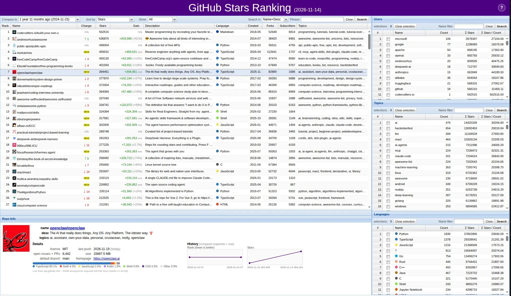

# github-stars-ranking

**Live demo: <https://pkarpiuk.github.io/github-stars-ranking/>**

[](https://pkarpiuk.github.io/github-stars-ranking/)

A ranking of GitHub repositories by stars (top 10,000): Change and Gain columns relative to a selected earlier ranking, sorting,
filters (users, topics, languages), history charts and repository details. A static page (ExtJS 4) on **GitHub Pages**;
the data is refreshed once a week by **GitHub Actions** (no server).

## How it works

```
Monday 04:17 UTC (Actions)
  └─ update.rb  ── GitHub GraphQL ──►  _site/db.js  (ranking, COMPARE, language colors, metadata)
                └─ appends a snapshot to data/ranking-db.json (history)
  └─ site/ + _site/db.js  ──►  GitHub Pages
  └─ data/ranking-db.json, data/language_colors.json  ──►  commit to the `data` branch
```

- **`main`**: code (`update.rb`, `compare_snapshots.rb`, `language_colors.rb`), the page (`site/`), the workflow (`.github/workflows/update.yml`).
- **`data`**: history only: `ranking-db.json` (JSON-lines, appended every week, about 0.4 MB per snapshot; snapshots older than a year are thinned out to the first one in each quarter, see `history_thinning.rb`) and the refreshed `language_colors.json` dictionary.
  The page itself is not committed: `db.js` (about 5.7 MB) is built on every run and published as a Pages artifact.
- `update.rb` has a freshness gate: if the last snapshot is less than 6 days old, it fetches nothing (the `force` option of a manual run overrides this).

## First run

1. **A public GitHub repository** (Actions are then free and Pages is available on the free plan). Push `main`.
2. **Pages:** Settings → Pages → *Build and deployment* → Source: **GitHub Actions**.
3. **Token:** create a fine-grained token (Settings → Developer settings → Personal access tokens; scope: public repositories only,
   no write permissions) and save it as the `STARS_TOKEN` secret (Settings → Secrets and variables → Actions). Without the secret the workflow
   uses the built-in `GITHUB_TOKEN`, but its GraphQL rate limit has not been verified.
4. **The `data` branch** with the existing history (the seed is kept locally in `data/ranking-db.json`, ignored in `main`):
   ```
   git worktree add --orphan -b data ../github-stars-ranking-data
   cp data/ranking-db.json ../github-stars-ranking-data/
   cd ../github-stars-ranking-data && git add ranking-db.json && git commit -m "Ranking history (seed)" && git push -u origin data
   ```
   (requires git 2.42+). Without this branch the first run fails at checkout.
5. **First run:** Actions → *Aktualizacja rankingu i wdrożenie na GitHub Pages* (the workflow's name is in Polish) → Run workflow (tick `force`, because the last snapshot
   from the seed may be recent). The page address: `https://<user>.github.io/github-stars-ranking/`.

After that the workflow runs by itself every Monday. Options of a manual *Run workflow*:

| Option | Effect |
|---|---|
| (none) | fetches the ranking only if the last snapshot is 6 days old or older, otherwise does nothing |
| `force` | fetches the ranking even though the last snapshot is recent (appends another snapshot to the history) |
| `redeploy_only` | **after changing the page only** (`site/`: `main.js`, `index.html`, etc.): takes `db.js` from the running site, combines it with the current `site/` and deploys; fetches nothing from the GitHub API and does not touch the history (takes precedence over `force`) |

## Running locally

```
GITHUB_TOKEN=... ruby update.rb [--force]       # needs only Ruby 3 (standard library, no gems): sudo apt-get install ruby
cp -r site/. _site/ && cd _site && python3 -m http.server 8000     # http://localhost:8000/
```

Default paths: history `data/ranking-db.json`, output `_site/db.js`. Variables: `RANKING_DB`, `OUTPUT_DB_JS`, `RANKING_LANG_COLORS`, `RANKING_SIZE` (10000),
`MIN_STARS` (1000), `PAGE_SIZE` (50), `MIN_INTERVAL` (518400 s). A full fetch of 10,000 repositories takes about 200 GraphQL queries and several to a dozen minutes.

## Notes and limitations

- **GitHub Pages:** site up to 1 GB, bandwidth 100 GB/month (a soft limit), no custom cache headers. The page weighs about 1.8 MB compressed (`db.js`).
- **The Actions schedule** may be delayed (especially at the top of the hour) and in a public repository it **is disabled after 60 days without repository activity**;
  the weekly commit to the `data` branch should prevent this, but that has not been verified. If the schedule disappears, re-enable the workflow in the Actions tab.
- A fetch error (rate limit, network) ends the run without saving and without deploying: Pages stays on the previous version and the history gets no entry.
- There are no automated tests; `update.rb` was tested against a mock of the API (see `CLAUDE.md`), and the workflow runs in production (scheduled and manual runs).
